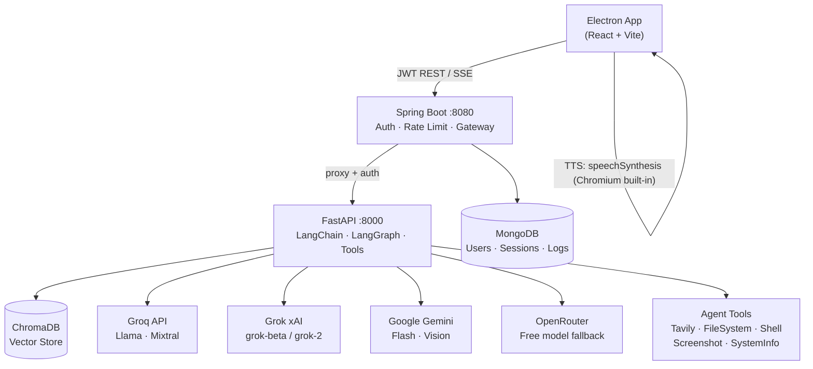
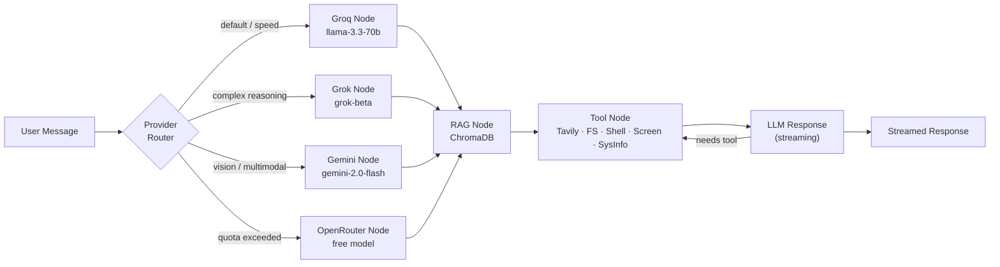
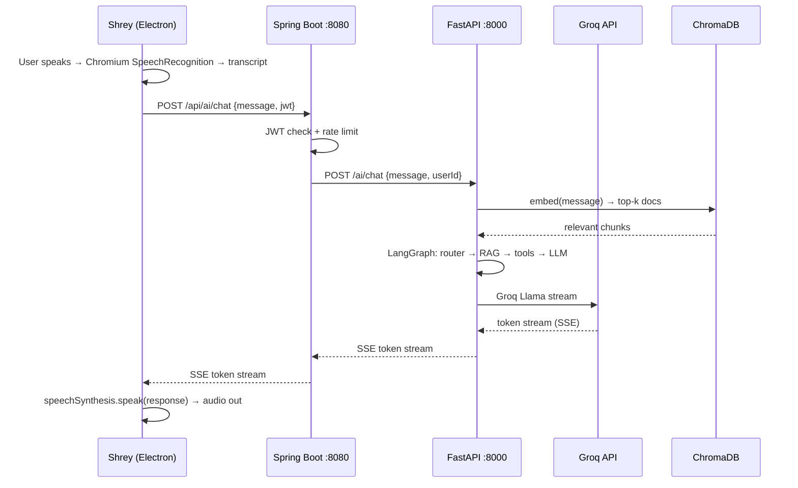

# Shrey AI — Full Project Plan

> **AI Voice Assistant Desktop App** · Electron + React · Spring Boot · FastAPI + LangChain/LangGraph · ChromaDB · MongoDB
> **LLM Providers:** Groq · Grok (xAI) · OpenRouter · Google Gemini

---

## 🗂 Repository Layout

```
shrey_Ai/
├── frontend/          ← Electron + React (desktop app)
├── backend/           ← Spring Boot (auth gateway + REST API)
└── Ai/                ← Python FastAPI (RAG, embeddings, LLM, tools)
```

---

## ⚙️ Environment Prerequisites

> [!WARNING]
> **Java, Maven, and Python are not installed on this PC.** Install these before scaffolding backend/AI services.

| Tool | Required Version | Status |
|------|-----------------|--------|
| **Java (JDK 21)** | 21 LTS | ❌ Not installed |
| **Maven** | 3.9+ | ❌ Not installed |
| **Python** | 3.11+ | ❌ Not installed |
| **Node.js** | v26.13.0 | ✅ Installed |
| **npm** | 11.20.0 | ✅ Installed |
| **MongoDB** | 7+ | Install via winget or Atlas |
| **ChromaDB** | latest | `pip install chromadb` |

### Quick Install (Admin PowerShell)
```powershell
winget install EclipseAdoptium.Temurin.21.JDK
winget install Apache.Maven
winget install Python.Python.3.11
winget install MongoDB.Server
# Restart terminal, then verify:
java -version && mvn -version && python --version
```

---

## 🤖 LLM & Voice Provider Strategy

Shrey uses **four LLM providers** in a priority chain. The LangGraph router picks the best model per request type, with automatic fallback.

### LLM Providers

| Priority | Provider | Models | Use Case | Cost |
|----------|---------|--------|----------|------|
| 1 | **Groq** | `llama-3.3-70b-versatile`, `mixtral-8x7b` | Main chat — ultra-fast inference | Free tier (generous) |
| 2 | **Grok (xAI)** | `grok-beta`, `grok-2` | Complex reasoning, long context | Paid |
| 3 | **Google Gemini** | `gemini-2.0-flash`, `gemini-1.5-flash` | Multimodal, code, vision | Free tier |
| 4 | **OpenRouter** | `meta-llama/llama-3.1-8b-instruct:free`, `google/gemma-2-9b-it:free`, `mistralai/mistral-7b-instruct:free` | Fallback, free-tier overflow | Free |

> [!TIP]
> Groq is the **default** for speed. The LangGraph router switches to Grok for heavy reasoning, Gemini for multimodal/vision, and OpenRouter free models when Groq quota is exhausted.

---

### Voice — STT (Speech-to-Text)

> [!NOTE]
> **100% free, zero install, zero API calls.** Electron bundles Chromium — `SpeechRecognition` is built right in. Windows `System.Speech` handles fully offline use. Nothing to pay, nothing to download, no model.

| Priority | Provider | Where It Runs | Cost | Network? |
|----------|---------|--------------|------|----------|
| 1 | **Chromium `SpeechRecognition`** | Electron renderer — Chromium built-in | Free | Uses Google STT servers |
| 2 | **Windows `System.Speech`** | Electron main process → PowerShell IPC | Free | Fully offline |

**Primary flow:**
```
Mic → window.SpeechRecognition (Chromium built-in) → transcript text
```

**Offline fallback (no network, no API key):**
```js
// electron/ipc/stt.js
ipcMain.handle('stt:windows', async () => {
  const ps = `Add-Type -AssemblyName System.Speech;
    $r = New-Object System.Speech.Recognition.SpeechRecognitionEngine;
    $r.SetInputToDefaultAudioDevice();
    $r.LoadGrammar((New-Object System.Speech.Recognition.DictationGrammar));
    ($r.Recognize()).Text`;
  return await runPowerShell(ps);
});
```

> [!TIP]
> No `/ai/transcribe` endpoint. STT never touches FastAPI or any paid model.

---

### Voice — TTS (Text-to-Speech)

> [!NOTE]
> **100% free, zero install.** `window.speechSynthesis` is built into Chromium/Electron — uses Windows voice packs already on the machine. No API key, no MP3 stream, no server call.

| Provider | Where It Runs | Cost | Network? |
|---------|--------------|------|----------|
| **`window.speechSynthesis`** | Electron renderer — Chromium + Windows voices | Free | Fully offline |

**Flow:**
```
AI response text → window.speechSynthesis.speak(utterance) → audio out
```

```js
// hooks/useTTS.js
export function useTTS() {
  const speak = (text, { rate = 1, pitch = 1, voice } = {}) => {
    const u = new SpeechSynthesisUtterance(text);
    u.rate = rate; u.pitch = pitch;
    if (voice) u.voice = voice;
    window.speechSynthesis.cancel(); // stop any current speech
    window.speechSynthesis.speak(u);
  };
  const stop = () => window.speechSynthesis.cancel();
  const voices = () => window.speechSynthesis.getVoices(); // list Windows voices
  return { speak, stop, voices };
}
```

> [!TIP]
> No `/ai/speak` endpoint. TTS never touches FastAPI or any API.

---

## 🏗 Architecture Overview



---

## 1. Frontend — Electron + React

### Stack
| Package | Purpose |
|---------|---------|
| `electron` v31 | Desktop shell |
| `react` + `react-dom` v18 | UI |
| `vite` + `electron-vite` | Build |
| `tailwindcss` | Styling |
| `zustand` | State (chat, auth, voice, settings) |
| `axios` | HTTP + SSE streaming |
| `motion` | Animations (`import { motion } from "motion/react"`) |
| `@electron/remote` | Computer access IPC |
| `electron-store` | Persist settings/token locally |

### Voice — STT Hook
```js
// hooks/useSpeechRecognition.js
// Chromium built-in — no model, no download, no server call
export function useSpeechRecognition({ onResult }) {
  const recognition = useRef(null);

  useEffect(() => {
    const SR = window.SpeechRecognition || window.webkitSpeechRecognition;
    if (!SR) return; // falls back to Windows System.Speech via IPC
    recognition.current = new SR();
    recognition.current.continuous = false;
    recognition.current.interimResults = true;
    recognition.current.lang = 'en-US';
    recognition.current.onresult = (e) => {
      const transcript = Array.from(e.results)
        .map(r => r[0].transcript).join('');
      onResult(transcript, e.results[e.results.length - 1].isFinal);
    };
  }, []);

  return {
    start: () => recognition.current?.start(),
    stop:  () => recognition.current?.stop(),
  };
}

// Offline fallback — renderer calls:
// window.electronAPI.stt.start() → main process → PowerShell System.Speech
```

### Electron IPC — Computer Access
```
electron/
├── main.js          ← BrowserWindow, IPC server
├── preload.js       ← contextBridge (safe surface)
└── ipc/
    ├── filesystem.js  ← dialog open/save + read/write
    ├── shell.js       ← whitelisted shell commands
    ├── screen.js      ← screenshot via desktopCapturer
    └── stt.js         ← Windows System.Speech offline fallback
```

> [!CAUTION]
> `contextIsolation: true`, `nodeIntegration: false`. Only expose named IPC channels via `contextBridge`. Never expose raw `fs` or `child_process` to the renderer.

### Folder Structure
```
frontend/
├── electron/
│   ├── main.js
│   ├── preload.js
│   └── ipc/
│       ├── filesystem.js
│       ├── shell.js
│       ├── screen.js
│       └── stt.js
├── src/
│   ├── components/
│   │   ├── VoiceButton.jsx      ← animated mic, waveform pulse
│   │   ├── ChatWindow.jsx
│   │   ├── MessageBubble.jsx
│   │   ├── ProviderBadge.jsx    ← shows which LLM answered
│   │   └── SettingsPanel.jsx   ← API keys, voice speed/pitch, LLM selector
│   ├── stores/
│   │   └── chatStore.js
│   ├── hooks/
│   │   ├── useSpeechRecognition.js
│   │   └── useTTS.js
│   ├── services/
│   │   └── api.js               ← axios + SSE helper
│   ├── App.jsx
│   └── main.jsx
├── package.json
└── vite.config.js
```

---

### UI Design System — ace-design-skill

> [!IMPORTANT]
> **All frontend UI is built using the `ace-design-skill`** (`~/.gemini/config/skills/ace-design-skill/SKILL.md`). Every component, colour, spacing, typography, and animation decision follows the Ace visual system. Any agent working on the frontend must activate this skill before writing or editing UI files.

#### Design Tokens
| Token | Value | Used For |
|-------|-------|---------|
| Canvas | `neutral-300` · `#d4d4d4` | App background |
| Primary blue | `#407cf9` | Buttons, focus rings, accents |
| Dark surface | `#0e0b1a` | AI message bubbles, sidebar |
| Text primary | `neutral-900` | Main readable text |
| Text muted | `neutral-600` | Timestamps, hints |
| `font-display` | Geologica | "Shrey" logo, headings |
| `font-mono` | Outfit | Chat text, labels, buttons |

#### Key UI Components (Ace system)
| Component | Ace Source | Shrey Usage |
|-----------|-----------|-------------|
| `Button` | `components/ui/button.tsx` | Mic button (`lg` primary), Send, Settings |
| `Input` | `components/ui/input.tsx` | Text input bar, Settings fields |
| `Logo` | `components/logo.tsx` | "Shrey" wordmark in sidebar header |
| `InlineIcon` | `components/ui/inline-icon.tsx` | LLM provider badge (Groq / Grok / Gemini) |

#### Voice Button (Ace `lg` primary + `motion`)
```jsx
import { motion } from "motion/react";
// Animated waveform rings pulse outward while listening
// Ace lg button: 72px high, 24px radius, #407cf9 gradient
<motion.div
  animate={listening ? { scale: [1, 1.15, 1] } : {}}
  transition={{ repeat: Infinity, duration: 1.2 }}>
  <Button variant="primary" size="lg" color="#407cf9">
    {listening ? <MicOn /> : <MicOff />}
  </Button>
</motion.div>
```

#### Layout
- **Left sidebar** (dark `#0e0b1a`): Shrey logo + conversation history
- **Centre** (canvas `#d4d4d4`): chat bubble stream
- **Bottom bar** (light neutral): text input + voice button + send
- **Right panel** (slide-in): Settings — API keys, voice speed/pitch, LLM selector
- Responsive: panels stack vertically on small windows

---

## 2. Backend — Spring Boot

### Stack
| Dependency | Purpose |
|-----------|---------|
| `spring-boot-starter-web` | REST + proxy |
| `spring-boot-starter-security` | Filter chain |
| `spring-boot-starter-data-mongodb` | MongoDB ODM |
| `jjwt` 0.12.5 | JWT sign/verify |
| `bucket4j-core` 8.10.1 | Per-user rate limiting |
| `spring-boot-starter-actuator` | Health endpoints |

### MongoDB Collections
```
users          { _id, name, email, passwordHash, role, createdAt }
sessions       { _id, userId, token, expiresAt }
rate_limits    { _id, userId, requestCount, windowStart, provider }
audit_logs     { _id, userId, action, provider, model, timestamp }
```

### Rate Limit Strategy
- Per user, per provider: 60 req/min to Groq, 20 req/min to Grok, 100 req/min to Gemini/OpenRouter
- Bucket4j in-memory buckets keyed by `userId:provider`
- 429 response includes `Retry-After` header

### Folder Structure
```
backend/src/main/java/com/shreyai/
├── config/
│   ├── SecurityConfig.java
│   └── MongoConfig.java
├── controller/
│   ├── AuthController.java      ← /auth/register, /auth/login
│   └── ProxyController.java     ← /api/** → FastAPI
├── service/
│   ├── AuthService.java
│   ├── JwtService.java
│   └── RateLimitService.java    ← Bucket4j per userId+provider
├── model/
│   ├── User.java
│   └── AuditLog.java
├── repository/
│   └── UserRepository.java
└── filter/
    └── JwtAuthFilter.java
```

---

## 3. AI Service — Python FastAPI

### Stack
| Package | Purpose |
|---------|---------|
| `fastapi` + `uvicorn` | Web server |
| `langchain` + `langchain-community` | Orchestration |
| `langgraph` | Multi-step agent graph |
| `langchain-groq` | Groq LLM |
| `langchain-xai` | Grok (xAI) LLM |
| `langchain-google-genai` | Gemini LLM |
| `langchain-openai` | OpenRouter (OpenAI-compatible base URL) |
| `chromadb` | Vector store |
| `sentence-transformers` | Local embeddings |
| `tavily-python` | Web search tool |
| `pyautogui` | Screenshot tool |
| `psutil` | System info tool |
| `pymongo` | MongoDB logging |
| `python-jose` | JWT verification |
| `pydantic` v2 | Schema validation |

### LangGraph Agent — Provider Router



> [!NOTE]
> **No STT or TTS endpoints.** Voice is handled entirely inside Electron for free using Chromium built-in APIs. FastAPI only handles LLM chat, RAG ingestion, and agent tools.

### OpenRouter Config (OpenAI-compatible)
```python
from langchain_openai import ChatOpenAI

openrouter_llm = ChatOpenAI(
    base_url="https://openrouter.ai/api/v1",
    api_key=os.getenv("OPENROUTER_API_KEY"),
    model="meta-llama/llama-3.1-8b-instruct:free",
)
```

### RAG Pipeline
1. `POST /ai/ingest` → chunk → embed (`all-MiniLM-L6-v2`) → ChromaDB
2. Query → embed → top-k similarity search → inject into prompt context

### Tools
| Tool | Library | Capability |
|------|---------|-----------|
| `TavilySearchResults` | `tavily-python` | Real-time web search |
| `FileSystemTool` | `langchain_community` | Read/write local files |
| `ShellTool` | `langchain_community` | Run whitelisted shell commands |
| `ScreenshotTool` | `pyautogui` | Capture screen → base64 |
| `SystemInfoTool` | `psutil` | CPU, RAM, disk, processes |

### Folder Structure
```
Ai/
├── main.py
├── requirements.txt
├── agent/
│   ├── graph.py          ← LangGraph StateGraph
│   ├── nodes.py          ← RAG, LLM, tool nodes
│   ├── router.py         ← provider selection logic
│   └── tools.py
├── providers/
│   ├── groq_provider.py
│   ├── grok_provider.py
│   ├── gemini_provider.py
│   └── openrouter_provider.py
├── rag/
│   ├── ingest.py
│   └── retriever.py
├── models/
│   └── schemas.py
└── auth/
    └── jwt_verify.py
```

### `requirements.txt`
```
fastapi==0.115.0
uvicorn[standard]==0.30.0
langchain==0.3.0
langchain-community==0.3.0
langchain-groq==0.2.0
langchain-xai==0.1.0
langchain-google-genai==2.0.0
langchain-openai==0.2.0
langgraph==0.2.0
chromadb==0.5.0
sentence-transformers==3.1.0
tavily-python==0.3.0
pyautogui==0.9.54
psutil==6.0.0
pymongo==4.8.0
python-jose[cryptography]==3.3.0
pydantic==2.8.0
python-multipart==0.0.9
```

---

## 4. End-to-End Data Flow



---

## 5. Environment Variables

### `frontend/.env`
```env
VITE_API_BASE_URL=http://localhost:8080/api
```

### `backend/src/main/resources/application.properties`
```properties
spring.data.mongodb.uri=mongodb://localhost:27017/shreyai
jwt.secret=your-256-bit-secret-key
jwt.expiration=3600000
server.port=8080
ai.service.url=http://localhost:8000
```

### `Ai/.env`
```env
# LLM providers
GROQ_API_KEY=gsk_...
XAI_API_KEY=xai_...
GOOGLE_API_KEY=AIza...
OPENROUTER_API_KEY=sk-or-...

# Tools
TAVILY_API_KEY=tvly-...

# Infra
MONGO_URI=mongodb://localhost:27017/shreyai
JWT_SECRET=your-256-bit-secret-key
CHROMA_PERSIST_DIR=./chroma_db

# Provider routing
DEFAULT_LLM_PROVIDER=groq
```

---

## 6. API Keys You Need

| Service | Sign Up | Free Tier |
|---------|---------|-----------|
| **Groq** | console.groq.com | Generous — Llama 3.3 70B |
| **Grok (xAI)** | console.x.ai | Some free credits |
| **Google Gemini** | aistudio.google.com | 1M tokens/day free |
| **OpenRouter** | openrouter.ai | Many `:free` models |
| **Tavily** | tavily.com | 1000 req/month free |

---

## 7. Phase-by-Phase Build Plan

| Phase | What Gets Built | Day |
|-------|----------------|-----|
| **1 — Setup** | Install Java, Python, MongoDB. Init 3 projects. | 1 |
| **2 — Auth** | Spring Boot register/login, JWT, MongoDB user model | 2–3 |
| **3 — AI Core** | FastAPI + Groq Llama basic chat endpoint | 4–5 |
| **4 — Multi-Provider** | Grok, Gemini, OpenRouter nodes + router logic | 6–7 |
| **5 — RAG** | ChromaDB ingest + retrieval pipeline | 8–9 |
| **6 — Tools** | Tavily, FileSystem, Shell, Screenshot, SysInfo in LangGraph | 10–11 |
| **7 — Electron UI** | React chat UI, VoiceButton, ProviderBadge, SettingsPanel (ace-design-skill) | 12–14 |
| **8 — Voice** | Chromium STT hook + speechSynthesis TTS hook + Windows IPC fallback | 15 |
| **9 — Integration** | Full end-to-end: speak → chat → speak | 16–17 |
| **10 — Rate Limit + Audit** | Bucket4j per provider, audit log, error handling | 18 |
| **11 — Packaging** | `electron-builder` → Windows `.exe` installer | 19 |

